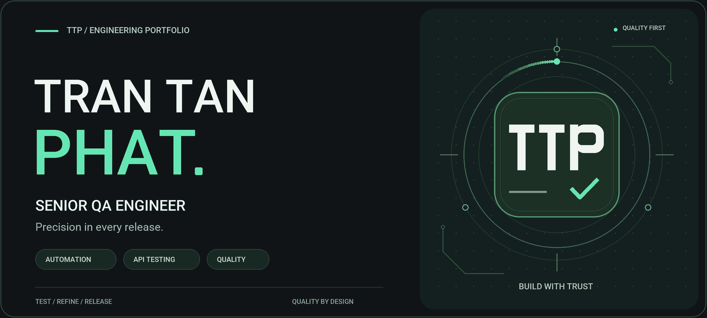

<p align="center">
  
</p>

# Tran Tan Phat · Senior QA Portfolio

Personal portfolio and owner workspace for **Tran Tan Phat, Senior Quality Assurance Engineer**. The public site presents experience, skills, projects, achievements, education and contact details. Admin manages content, reviewed CVs, private career evidence and AI assistance.

Built with HTML, compiled Tailwind CSS and Vanilla JavaScript. The portfolio runs on static hosting; Firebase provides authentication, content storage and CV artifacts. AI uses an optional protected backend.

## Quick start

Use Node.js 22 or newer for development.

```bash
npm install
npm start
```

Open **http://127.0.0.1:5173/**. On Windows, double-click `start-local-server.bat`. Stop the server with `Ctrl+C`. For another port, run `node tools/local-server.cjs 5174 127.0.0.1`.

Run `npm run build` after changing Tailwind classes or rebuilding bundled assets. Generated CSS and vendor assets are committed for static hosting.

## Features

- Responsive portfolio with project details, media previews and contact links.
- Firestore content rendering, local cache and bundled fallback data.
- Owner-only editing, reordering and custom blocks with private drafts, publish, hide/restore and Undo.
- Admin workspace with Overview, Content, CV Studio, AI Assistant and Settings.
- CV Studio with content selection, layout presets, PDF previews, page fitting, private JD variants and reviewed AI proposals.
- Private Facts & evidence library with verification and migration backups.
- Official CV publication with frozen PDF artifacts, hash checks, private release history and exact-byte rollback.
- OpenAI API, Claude CLI and Custom API connections shared across AI tasks.

## Admin and CV Studio

Open **Admin Login** in the footer, press `Ctrl+Shift+A`, or triple-click the footer. Sign in with the owner account in Firebase Authentication; the password is not stored in source code.

CV Studio follows **Content → Layout → AI assist → Review**. Review proposals before applying them. Page targets use measured PDF proposals and before/after diffs; over-limit documents cannot be saved or exported. Auto mode retains selected content without a page target. Advanced controls cover typography, spacing, margins, alignment and ordering. Draft-preserving navigation, zoom and Undo support review.

Portfolio edits and private job descriptions do not automatically replace the official CV. The reviewed local [PDF](cv/CV_TranTanPhat_SeniorQA_Reviewed.pdf) and [snapshot](cv/CV_TranTanPhat_SeniorQA_Reviewed.json) become public only after the authenticated owner publishes the official version. Existing renderer-v1 snapshots remain compatible; reviewed layout configuration uses renderer v2.

New official releases store immutable PDFs in Firebase Storage. Visitors download the published artifact; rollback reactivates the previous release's exact bytes. Publication requires online sync and reviewed career facts.

**Storage setup is still required for new frozen PDF releases**, according to the [11 October 2026 setup review](docs/ADMIN_PERMISSIONS_AND_CV_STUDIO_FIX.md). Create or connect the bucket, verify `storageBucket` in `js/firebase-config.js`, deploy `storage.rules` and configure CORS. Preview, editing and private Firestore drafts remain available independently of this setup.

## Local AI service

```bash
npm run admin:local
```

Alternatively, double-click `start-admin-workspace.bat`. Open **http://127.0.0.1:5180/**, sign in as Admin, then choose a provider in **Settings → AI providers**. Keep the service running while using AI.

| Provider | Setup |
| --- | --- |
| OpenAI API | Configure credentials through the protected backend, choose a model and test the connection. |
| Claude CLI | Install Claude Code and run `claude auth login` on the machine running the service. In the Claude CLI panel, choose Fast / Balanced / Best, then **Test & activate**. No API key is needed. |
| Custom API | Configure a compatible endpoint, credentials and model through the protected backend, then test the connection. |

Local browser pairing is **optional by default**. To require a terminal pairing code, start the service with `PORTFOLIO_REQUIRE_PAIRING=1`. In PowerShell:

```powershell
$env:PORTFOLIO_REQUIRE_PAIRING = '1'
npm run admin:local
```

When enabled, enter the terminal code in Settings. Owner authentication is required with or without pairing. The default service accepts the portfolio at ports `5173` and `5180`, and the configured GitHub Pages origin.

Connection tests check service availability, authentication/pairing, credentials or CLI login, structured JSON and plain-text replies. Changing configuration invalidates its previous test. Claude activation is stored in the current browser; optional Effort controls are passed to the CLI, which uses the task prompt in place of its default agent prompt.

Static hosting serves the portfolio while AI uses the backend. `Dockerfile.ai` provides an API-only hosted option. See [Admin AI Studio setup](docs/ADMIN_AI_STUDIO_IMPLEMENTATION.md) for backend configuration and hosted deployment; the optional pairing behavior above reflects the current server implementation.

## Firebase and content sync

Configure Firebase in [js/firebase-config.js](js/firebase-config.js), create the owner account in Firebase Authentication and deploy the repository's rules for your project before enabling Admin writes.

| Location | Purpose |
| --- | --- |
| `portfolio/{section}` | Public sections: header, summary, experience, skills, projects, achievements, education, contact, plus metadata, custom-blocks and cv. |
| `admin/*` | Owner-only AI settings, context, career facts, migration backups and private CV drafts/variants. |
| `cv-releases/*`, `cv-release-events/*` | Private release history and publication/rollback events. |
| Firebase Storage | Frozen official CV PDF artifacts. |

AI settings belong in **`admin/ai-config`**, outside the public portfolio collection. Private context and credentials are excluded from public content and seed exports.

The public content read path is:

```text
Firestore → localStorage cache → bundled js/db-seed.js
```

Successful reads refresh the cache. When Firebase is unavailable, the UI uses cached or bundled content. Reconnection refreshes public data. Existing section edits made offline enter a pending queue with conflict resolution; writes use revisions to detect concurrent changes. Official CV and custom-block publication require online sync. Private/device drafts preserve work during an outage.

The Admin connection indicator shows **green** for connected, **red** for disconnected and **yellow** while syncing pending writes.

### Seed content

Start the local server and open **http://127.0.0.1:5173/tools/seed.html** to inspect or seed data. Sign in as the owner before writing. You can also use the browser's DevTools console:

```js
import('/js/db-seed.js').then(m => m.seedAll())
```

Seeding writes bundled defaults to Firestore; review the target project and content first. `js/db-seed.js` also supplies the fallback when no cache exists.

## Project structure

```text
.
├── index.html                  # Public portfolio
├── css/                        # Site styles, Tailwind input and generated CSS
├── image/                      # Logos, photos and project/certification assets
├── js/
│   ├── firebase-config.js      # Auth, Firestore, Storage and sync
│   ├── db-seed.js              # Bundled fallback and seed functions
│   ├── local-portfolio-cache.js
│   ├── portfolio-loader.js     # Public loader entrypoint (shim)
│   ├── loader/app.js           # Public rendering implementation
│   ├── admin-mode.js           # Admin entrypoint (shim)
│   ├── admin/                  # Workspace, content tools and CV Studio
│   ├── ai/                     # Provider settings, services and tasks
│   ├── career/                 # Typed career facts and verification
│   ├── cv/                     # CV model, layout, PDF and releases
│   ├── portfolio/              # Custom blocks and rendering
│   └── page/                   # Navigation, dialogs and page behavior
├── tools/                      # Local servers, AI bridge, build and seed tools
├── vendor/                     # Committed PDF libraries and fonts
├── cv/                         # Local reviewed CV artifacts
├── tests/                      # Unit, browser, PDF and Firebase rules checks
├── docs/                       # Setup, implementation reviews and AI context
├── firestore.rules
├── storage.rules
├── storage.cors.example.json
└── firebase.json
```

## Brand assets

The brand combines a geometric **TTP** monogram with a green QA check and graphite tones matching the portfolio. The README uses a tall, full-width banner with oversized name typography and a large monogram inside an animated verification orbit. The logo outline and check gently pulse while the name and title stay still for readability.

| Asset | Use |
| --- | --- |
| [image/readme-banner.gif](image/readme-banner.gif) | Animated README banner, 1600 × 720, with a seamless six-second loop. |
| [image/readme-banner.png](image/readme-banner.png) | Static version of the banner for previews or placements that require a still image. |
| [image/logo.svg](image/logo.svg) | Compact horizontal name/title lockup on a light background. |
| [image/logo-icon.svg](image/logo-icon.svg) | Compact monogram used by the existing site favicon. |

The compact logos are SVG and remain sharp at any size. Keep all assets' aspect ratios when resizing. Rebuild the GIF and PNG with `python tools/build-readme-banner.py` (requires Pillow); the generator uses the repository's bundled Roboto fonts.

## Build and verification

```bash
npm run build
npm test
```

For browser checks, keep `npm start` running in a separate terminal:

```bash
npx playwright install chromium
npm run test:browser
```

PDF text/link checks require Python with PyMuPDF:

```bash
python -m pip install PyMuPDF
npm run test:pdf
```

Firebase rules checks require Firebase CLI and Java 21 or newer:

```bash
npm run test:rules
```

Rules tests use the demo project in `firebase.emulators.json`. The public portfolio needs no Node server in production. Firebase SDK modules load from the official CDN.

## Development notes and documentation

Keep `data-pl="..."` anchors in `index.html` stable: the loader uses them to render sections. New sections need matching seed data, rendering and Admin forms. Store local images under `image/` and use relative paths. Local cache supplements Firestore when offline.

The stack also includes Firebase Auth/Storage, IntersectionObserver motion controls, SortableJS, EmailJS, the SVG icon registry, pdfmake with embedded Unicode fonts and PDF.js previews.

Scroll uses browser-native wheel/trackpad/touch input. Navigation buttons use interruptible smooth scrolling; ambient hero effects pause outside the viewport, while scrolling and when the tab is hidden. See [scroll and motion implementation](docs/SCROLL_AND_MOTION_IMPLEMENTATION.md) for changes, measurements and verification. Rebuild responsive portrait assets with `python tools/optimize-portfolio-images.py` (requires Pillow).

- [Admin AI Studio implementation and setup](docs/ADMIN_AI_STUDIO_IMPLEMENTATION.md)
- [CV synchronization and design review](docs/CV_DESIGN_REVIEW.md)
- [CV configuration and AI proposals](docs/CV_CONFIG_AGENT_IMPLEMENTATION.md)
- [Career facts and immutable CV releases](docs/CAREER_FACTS_AND_IMMUTABLE_CV.md)
- [Admin permissions, CV Studio and Storage setup](docs/ADMIN_PERMISSIONS_AND_CV_STUDIO_FIX.md)
- [Project AI context](docs/AI_CONTEXT.md)
