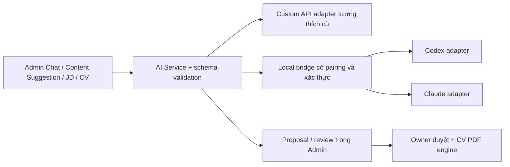

# Plan Admin Workspace, AI providers, Custom Layout và CV theo JD

Ngày review: 10/10/2026. Trạng thái: **plan đã đối chiếu code và CLI trên máy; chưa triển khai các chức năng mới trong tài liệu này**.

## 1. Phạm vi và kết quả cần đạt

- Thiết kế lại giao diện Admin để Content, AI, CV và Config dễ tìm, ít modal chồng nhau.
- Giữ Custom API hiện có; bổ sung **OpenAI / Codex CLI** và **Claude Code CLI**.
- Config tập trung cho AI, mặc định CV, custom field/layout và đồng bộ dữ liệu.
- Thêm field/block tùy chỉnh, có schema và renderer; dữ liệu dùng được ở portfolio và CV.
- CV Studio có JD, phân tích mức phù hợp có bằng chứng, đề xuất chọn nội dung/rewrite và xuất PDF sau khi duyệt.
- Giữ nguyên thứ tự section và nội dung portfolio hiện có. Layout mới áp dụng cho block mới hoặc tùy chỉnh được owner chọn rõ ràng.
- Review lại bằng unit/browser/PDF và kiểm tra CLI thực tế có xác thực trước khi gọi một provider là hoạt động.

## 2. Review hiện trạng từ code

| Thành phần | Hiện trạng | Việc cần đổi |
|---|---|---|
| `js/admin/app.js` | Khoảng 2.450 dòng: auth, toolbar, form, layout, Config, AI chat và AI suggestion cùng file | Tách module theo chức năng, giữ các window hook/DOM anchor đang dùng |
| Config | Form Base URL/API key/model nằm trong edit modal dùng chung | Chuyển thành tab Config; cấu hình từng provider và trạng thái riêng |
| AI transport | Chat, suggestion, connection test và CV gọi trực tiếp `/chat/completions` ở nhiều chỗ | Một service thống nhất, adapter riêng cho từng provider |
| API key | Base64 trong document private `admin/ai-config`; Base64 không phải mã hóa | Giữ tương thích dữ liệu cũ; secret mới ưu tiên lưu trên dịch vụ local, không trả credential CLI về browser |
| AI chat | Context lấy portfolio cho từng request; message gửi chỉ có system/user hiện tại | Bổ sung history giới hạn, cancel, trạng thái job và provider rõ ràng |
| CV | `model.js` → `service.js` → PDF; publication version 3 đã gắn nguồn | Tái sử dụng engine và cơ chế source invalidation, không thay bằng ảnh/chụp HTML |
| JD | Đã có `#am-cv-job`; gửi trong prompt Review/Optimize | Chưa có requirement matrix, rubric, bằng chứng, gap, so sánh trước/sau hoặc private profile |
| Custom field | Form/render/CV mapping cố định theo tám document chuẩn | Cần schema registry và mapping dùng chung, không chỉ thêm một input không có renderer |
| Custom layout | Move/Hide/Restore item có `_id`; chưa có block builder | Thêm builder có preset, preview, draft, undo và publish |
| Hosting | Website static; `tools/local-server.cjs` chỉ phục vụ file | Cần backend local chạy process CLI; static hosting không thực thi CLI |
| Firestore | Public document có allowlist, `admin/*` private; portfolio writes có revision/offline queue | Mở rộng allowlist có chủ đích cho custom schema/dữ liệu public, tách JD/profile/secret sang private |

AI chat hiện escape phản hồi bằng `esc()`, không cần coi nó là một lỗi Markdown injection đã được xác nhận. Renderer mới vẫn phải escape/sanitize mọi nội dung từ người dùng/AI.

### CLI trên máy — đã kiểm tra chỉ bằng metadata/help

- PATH `codex.cmd`: **0.130.0**. `features list` lỗi do cấu hình `service_tier = priority`, phiên bản này chỉ nhận `fast`/`flex`.
- Binary Codex đi kèm VS Code: **0.162.0-alpha.17.2**. Chưa kết luận bản alpha phù hợp để làm binary mặc định.
- `claude.cmd`: **2.1.261**. Có print mode, JSON/schema, tools restriction và MCP restriction.
- Chưa kiểm tra credential hoặc thực hiện inference; không đọc file token, không sửa cấu hình Codex toàn máy.
- `shell_tool` là feature hiện có của Codex PATH, được kiểm tra qua metadata với override riêng cho tiến trình; việc này không thay file config.

**Gate đầu tiên:** probe version/config/capabilities; chọn executable tương thích và cấu hình cho bridge. Chỉ sửa cấu hình của bridge, không âm thầm đổi `priority` thành một tier khác cho toàn bộ Codex trên máy.

## 3. Phân biệt OpenAI CLI, Codex và chat đang mở

Trong plan, lựa chọn chính là **OpenAI / Codex CLI**, vì máy có `codex` và nhu cầu là dùng khả năng AI đã đăng nhập. Codex hỗ trợ đăng nhập ChatGPT hoặc API key; hỗ trợ `codex exec` không tương tác và kết quả theo JSON schema. Tham khảo [OpenAI authentication](https://developers.openai.com/codex/auth/) và [non-interactive mode](https://developers.openai.com/codex/noninteractive/).

Lệnh **`openai` API CLI** là sản phẩm khác, sử dụng `OPENAI_API_KEY`; không phải cách tự động dùng gói chat đang có. Nếu cần đúng binary này, bổ sung adapter riêng sau transport chung; không đổi nhãn API CLI thành Codex. Tham khảo [OpenAI CLI](https://developers.openai.com/api/docs/libraries/openai-cli/).

Claude dùng `claude -p`, JSON/schema; output có `structured_output`, cần parse theo adapter thay vì đọc như Chat Completions. `--tools ""` không tự chặn MCP, phải cấu hình MCP riêng. Tham khảo [Claude headless](https://code.claude.com/docs/en/headless) và [CLI reference](https://code.claude.com/docs/en/cli-reference).

Website không thừa hưởng thread/history hiện tại của ứng dụng chat. Bridge sử dụng phiên đăng nhập CLI được hỗ trợ; Admin giữ lịch sử riêng và truyền context có giới hạn. Không cam kết quota/chi phí hay quyền truy cập model nếu chưa kiểm tra tài khoản.

Lưu ý phiên bản đã kiểm tra: `claude --bare` bỏ OAuth/keychain và yêu cầu API key/apiKeyHelper, nên **không dùng bare làm mặc định cho luồng muốn dùng đăng nhập subscription**. Chọn chế độ hạn chế tools/settings/MCP nhưng giữ auth phù hợp; kiểm tra effective capabilities bằng test riêng. Không bỏ sandbox/permissions để vượt lỗi login.

## 4. Thiết kế Admin Workspace

Workspace riêng mở sau đăng nhập, có sidebar, top bar và vùng nội dung lớn. Nút **View Portfolio** thu workspace để sửa trực tiếp như hiện tại; nút trở lại giữ draft. Không chuyển public portfolio sang một dashboard.

| Tab chính | Nội dung và thao tác |
|---|---|
| Content | Danh sách section, tìm kiếm, Add/Edit/Hide/Delete, custom field, trạng thái draft và sync |
| CV Studio | Base CV hoặc profile theo JD, chọn nội dung, JD analysis, diff và PDF preview |
| AI Assistant | Chat theo context được chọn, provider/model hiện tại, history, cancel và áp dụng proposal |
| Config | AI Providers · CV Defaults · Custom Fields & Layout · Data & Sync |

Top bar hiển thị riêng **Firebase**, **AI provider**, **Local bridge**, **Unsaved/Pending changes**. Không dùng một chấm màu để đại diện tất cả kết nối. Các action Save Draft, Publish, Export có tên thể hiện rõ tác dụng.

- Form Add/Edit dùng drawer hoặc dialog nhỏ; Workspace không dùng biến `currentData` chung cho mọi tab.
- Tab đổi không làm mất draft; restore sau đóng/mở; có cảnh báo chỉ khi thực sự bỏ một draft chưa lưu.
- Actions chính cố định tại vùng dễ thấy; toast cụ thể, không che input; inline error ở field sai.
- Desktop sidebar + pane rộng; mobile tab bar/drawer, một pane mỗi lần; tránh đặt JD/editor/PDF thành ba cột nhỏ trên điện thoại.
- Tab keyboard, focus ring, Escape/focus return, scroll lock qua dialog manager hiện có, reduced motion.
- Có bản xem bố cục tại `docs/admin-workspace-prototype.html`: chỉ là prototype minh họa, không hiển thị điểm AI giả như kết quả đã phân tích.

### Config → AI Providers

Provider selector: **Custom API / OpenAI (Codex CLI) / Claude CLI**.

- Custom API: protocol Chat Completions tương thích hiện tại, Base URL, model, secret storage, timeout; protocol khác cần adapter riêng, không giả định mọi Claude endpoint dùng `/chat/completions`.
- CLI: executable đã phát hiện, version, khả năng hỗ trợ, auth state đã lọc, model tùy chọn, timeout và giới hạn job.
- Hai thao tác khác nhau: **Check installation** không inference; **Test AI response** tạo một phản hồi ngắn để xác nhận hoạt động.
- Chỉ provider active đã test với fingerprint cấu hình hiện tại mới được hiển thị Ready. Đổi model/endpoint/binary làm test state hết hiệu lực.
- Không tự fallback sang dịch vụ khác có thể phát sinh chi phí; báo lỗi và để owner chọn provider thay thế.

### Config → CV Defaults

A4, font/size/spacing/margins, Auto hoặc 1–4 trang, preset nội dung, source sync và mặc định profile. Dùng **cùng model config** với CV Studio, không có hai nguồn giá trị riêng. Save defaults là cấu hình private; Publish Base CV là thao tác public riêng.

### Config → Custom Fields & Layout

Registry các field có label, type, required/validation, placement, visibility, mapping CV và thứ tự. Builder chỉ dùng preset/renderers được hỗ trợ; không nhận HTML/JS hoặc CSS tùy ý.

## 5. Kiến trúc AI dùng chung



Contract request: `task`, `provider`, `messages`, `context`, `responseSchema`, `settingsFingerprint`, `sourceFingerprint`, `requestId`. Task allowlist: chat, content-suggestion, cv-review, jd-analysis, cv-tailor. Browser không gửi executable path, shell command, cwd tùy ý hoặc extra CLI arguments.

Contract response: `requestId`, `provider`, `model`, `text/structured`, `usage` nếu có, trạng thái và lỗi chuẩn hóa. Structured output được validate ở bridge và client; không dùng eval hoặc coi output AI là command.

### Local bridge

Đề xuất `npm run admin:local`: một Node server loopback phục vụ chính giao diện và `/api/admin-ai/*`, tránh cross-origin cho luồng local. Server static hiện tại vẫn dùng được độc lập.

- Chỉ bind `127.0.0.1`; validate Host/Origin chính xác, không CORS wildcard. Pair token ngẫu nhiên, sống ngắn, không đặt trong URL/log; kiểm tra Firebase admin ID token cho thao tác AI. Check health chưa pair chỉ trả thông tin tối thiểu.
- Token verification dùng thư viện JWT chuẩn và public certificates của Firebase, validate signature/kid, issuer/audience/project, expiry và owner identity; không chỉ decode payload. Cách này không bắt owner đưa service-account key vào website. Nếu chọn Firebase Admin SDK thì phải đáp ứng yêu cầu service account riêng. Xem [Firebase ID token verification](https://firebase.google.com/docs/auth/admin/verify-id-tokens). Browser chỉ gửi token đến loopback đã pair và origin được phép, không forward token cho nhà cung cấp AI.
- Secret và executable configuration đặt ngoài static root; server không trả API key/CLI tokens. Public assets không chứa secret.
- `spawn` executable đã được allowlist + argument array, prompt qua stdin; không xây chuỗi shell từ JD. Trên Windows, `.cmd` wrapper cần resolver riêng: ưu tiên executable native hoặc Node + entrypoint đã xác minh; không bật shell với chuỗi prompt.
- Cwd là thư mục job riêng có schema/payload cần thiết; tránh để agent tự đọc repo, instruction file hoặc draft riêng khác.
- Codex: read-only, tắt shell/exec và plugin/MCP theo capabilities đã probe; read-only **không** đồng nghĩa tắt quyền đọc file. Không khai báo đã cô lập nếu công cụ còn truy cập dữ liệu ngoài task.
- Claude: disable built-in tools, deny MCP + strict empty MCP config, kiểm soát hooks/settings nhưng giữ cơ chế auth được chọn. JD là dữ liệu không đáng tin cậy.
- Request size, output size, timeout, concurrency; cancel phải dừng process tree trên Windows. Job status queued/running/completed/cancelled/failed. Không retry inference âm thầm.
- Error phân biệt not-installed, incompatible-config, not-authenticated, unsupported-model, quota/rate-limit, timeout, invalid-output, cancelled; log bỏ token/JD/CV đầy đủ mặc định.

Khi mở Admin trên hosting HTTPS: thử kết nối loopback với explicit pairing và exact origin; tính đến mixed-content/Local Network Access của từng browser. **Luồng local cùng origin là baseline đã hỗ trợ**. Khi browser chặn local bridge, hiển thị cách mở Admin local; không hứa CLI chạy trên GitHub Pages hay tự mở port ra Internet. Không có bridge thì Custom API và việc chỉnh/xuất CV thủ công vẫn dùng được.

## 6. Custom field và custom layout

### Schema tối thiểu

```json
{
  "id": "field-uuid",
  "label": "Languages",
  "type": "list",
  "required": false,
  "placement": {"sectionId": "summary", "blockId": "block-uuid"},
  "visibility": "public",
  "cv": {"enabled": true, "section": "Languages", "format": "bullets"}
}
```

MVP field types: text, multiline, number, date, link, list, tags. Mỗi block/field/list row có UUID; label đổi không đổi key và dữ liệu. URL qua `safeUrl`, required/type/range/max-length được validate. Prototype có thể minh họa fields tương lai nhưng chỉ renderer được triển khai mới chọn được trong bản thật.

MVP layouts: text block, bullet list, key/value, card grid, timeline. Spacing/width/columns theo preset responsive. Các custom block mới có anchor rõ ràng trong section hoặc sau section chuẩn; không move/delete các section gốc. CV renderer chuyển block public được bật CV về một cột theo mapping, không mang card grid đa cột sang PDF.

Vòng đời: create schema → nhập dữ liệu → preview → save draft → publish. Đổi type cần preview conversion hoặc tạo field mới; không ép chuyển làm mất dữ liệu. Hide giữ dữ liệu. Delete có undo/backup trước khi commit. Undo/redo ở draft, keyboard reorder và reset layout; lưu source refs theo UUID.

### Persistence và visibility

- Public: `portfolio/custom-schema`, `portfolio/custom-content`; thêm vào read allowlist, `readAllPortfolioDocs`, cache/seed export, loader validation và CV source loader.
- Schema/content public phải đồng bộ version. Publish bằng transaction có revision cho cả hai document + metadata; không để schema mới đọc nhầm dữ liệu cũ. Giới hạn payload theo giới hạn hiện tại của app.
- Private: schema/field/value private chỉ lưu trong `admin/*`. Không lưu private field rồi kỳ vọng frontend CSS sẽ giấu nó khỏi public document.
- Private defaults/profiles: `admin/cv-settings`, `admin/cv-profile.<UUID>`; nằm trong rules admin hiện có. Nếu chuyển sang subcollection phải thêm rules riêng; `admin/{docId}` hiện tại không tự cấp quyền subcollection.
- Source loader cho public CV không được đọc JD/private field. Owner-only CV dùng nguồn private theo lựa chọn rõ ràng và không tự Publish.

## 7. CV Studio theo JD

### Luồng thao tác

1. Chọn **Base CV** hoặc tạo **Application Profile**: tên vị trí, công ty, JD, ngôn ngữ CV, page limit, provider.
2. **Analyze JD**: AI trích requirements có ID, must-have/nice-to-have, trọng số, và bằng chứng có source field keys.
3. Hiển thị hai góc nhìn: bằng chứng trong **toàn portfolio hiện tại** và bằng chứng **đã đưa vào CV hiện tại**. Nhờ đó biết một skill thực sự thiếu hay chỉ bị bỏ khỏi bản CV đang chọn.
4. Requirement matrix: matched / partial / unknown / gap; câu trong JD, nguồn bằng chứng, lý do và confidence. Unknown không được coi là chắc chắn không có năng lực.
5. **Tailor CV**: đề xuất rewrite, đưa lại field/project có liên quan từ nguồn hoặc giảm nội dung ít liên quan trong profile. Có before/after, lý do và source refs.
6. Owner duyệt từng đề xuất. Giữ nguyên identity, employer, thời gian, credential, skill và metric thực tế. Không chuyển gap thành kinh nghiệm bịa hoặc thêm keyword không có bằng chứng.
7. Render PDF thật; kiểm tra page limit, source/draft freshness, typography và completeness. Hiển thị lại coverage theo cùng requirement set/rubric trước khi tải.
8. Save application profile private, export PDF theo tên vị trí/công ty. JD analysis/profile không tự thay portfolio hoặc CV public.

### Điểm phù hợp có thể giải thích

Tên điểm: **Evidence coverage / Mức độ đáp ứng có bằng chứng**, không gọi là điểm ATS hay xác suất được tuyển. AI đề xuất requirements và evidence; app tính điểm bằng rubric hiển thị rõ, ví dụ must-have 3, nice-to-have 1; matched 1, partial 0,5, unknown/gap 0. Owner có thể sửa requirement/weight nếu AI đọc JD sai. Các điều kiện bắt buộc thiếu phải được hiển thị riêng dù điểm tổng cao.

So sánh trước/sau dùng cùng requirement IDs/weights, không để AI tự đổi rubric để tăng điểm. Citation field key phải tồn tại và public/private scope phải đúng. Kinh nghiệm tính từ date cần gộp khoảng trùng nhau, không cộng hai job đồng thời thành nhiều năm. Các yêu cầu visa, location, level hoặc ngôn ngữ chưa có bằng chứng cần đánh dấu chưa xác minh.

### Profile và tự đồng bộ

Profile lưu JD, requirements, selection, overrides + nguồn tương ứng, source/config/JD fingerprints, provider/model và thời điểm phân tích trong private admin storage. Portfolio thay đổi sẽ cập nhật linked content và làm analysis cũ stale. Phải chạy lại analysis trước khi ghi nhận score mới; không giữ badge “matches JD” sau khi source đã đổi.

Giữ Base CV public riêng. Publish chỉ nhận whitelist style/selection/source-linked CV rewrite; không copy JD, job notes, báo cáo phù hợp, request log, API key hoặc token vào `portfolio/cv`. Private profile có export riêng; Publish Base CV là action riêng để tránh đưa bản nhắm một công ty cho mọi nhà tuyển dụng.

## 8. Modules và migration dự kiến

| File / nhóm file | Trách nhiệm |
|---|---|
| `js/admin/workspace.js`, `workspace-styles.js` | Shell, tabs, pane, focus, trạng thái và drafts |
| `js/admin/config/*` | AI Providers, CV Defaults, Custom Layout, Data/Sync |
| `js/ai/service.js`, `adapters/*`, `schemas.js` | Provider contract, normalize errors, structured validation, cancellation |
| `tools/admin-server.cjs`, `tools/ai-bridge/*` | Loopback server, auth/pairing, provider resolver, job lifecycle, CLI adapters |
| `js/custom/schema.js`, `renderers.js`, `cv-mapping.js` | UUID, schema/value validation, public render và CV render |
| `js/admin/cv/jd-analysis.js`, `profiles.js`, `proposal-review.js` | JD matrix, deterministic rubric, private profiles và diff |
| `js/cv/model.js`, `service.js`, `pdf.js` | Thêm custom mapping; giữ engine A4/font/page fitting và auto-sync |
| `js/firebase-config.js`, cache, loader, seed export, rules | Private settings/profiles và public custom docs với revision/transaction |

Migration `admin/ai-config` → provider config version 2 giữ nguyên Custom API đang dùng; backup trước, không xóa secret cũ trước khi transport mới test thành công. CV version 3 tiếp tục đọc được; tăng version khi thêm custom mapping và profile schema, giữ reader tương thích. Draft local được migrate có version, không mất overrides/selection.

Tách functions từng nhóm khỏi `app.js` theo từng phase; không rewrite tất cả auth/persistence cùng một lần. Các hook admin login, edit button, dialog manager và reload section vẫn được giữ hoặc có adapter tương thích.

## 9. Thứ tự implement và tiêu chí hoàn tất

| Phase | Deliverable | Điều kiện qua phase |
|---|---|---|
| 1 — Foundation | Shared AI service, schemas/errors, cấu hình version 2, migration | Custom API chat/suggestion/CV vẫn hoạt động; provider change không dùng test state cũ |
| 2 — CLI bridge | Same-origin local server, pairing/auth, executable probe, Codex/Claude adapters, cancel | Resolve lỗi config/version; test mock process + xác nhận minimal live JSON trên từng CLI có auth, không lộ token/không sửa repo |
| 3 — Admin Workspace | Tabs Content/CV Studio/AI/Config, status/drafts, CV Defaults | Add/Edit/Delete/Layout/Auth/Sync cũ pass; mobile actions dễ thấy, không mất draft |
| 4 — Custom schema/layout | Field builder, public renderer, CV mapping, transactional publish | Add/edit/hide/reorder/undo, reload/offline/conflict; public không đọc private values |
| 5 — JD workflow | Requirement matrix, rubric, tailoring diff, private profiles | Evidence refs hợp lệ; không thêm facts; scores stale đúng; PDF theo profile đúng trang |
| 6 — Review và tài liệu | Regression, PDF/visual review, local setup guide | Checklist dưới đây pass; ghi rõ phần chưa thể test thực nếu thiếu auth |

Không coi việc có dropdown provider hoặc mock response là đã tích hợp CLI thực tế. Khi chưa đăng nhập CLI, trạng thái phải là **Requires login**, không phải Connected; hướng dẫn đăng nhập terminal ngoài app và kiểm tra lại.

## 10. Review trước khi báo hoàn tất implementation

- **Providers:** old Custom API, Codex, Claude; chuyển provider/model; lỗi version/config/auth/quota; JSON sai; output quá lớn; cancel/timeout; Unicode, stdin, Windows executable có dấu cách; process tree được dừng.
- **Bridge:** reject unknown Origin/Host, request chưa pair/không phải admin, arbitrary command/path/arguments; JD chứa backticks/`$()` không biến thành shell; effective tools không truy cập file/command ngoài job; redaction log.
- **Admin:** chức năng cũ Add/Edit/Delete/Layout/Undo/Sync; auth expire; draft restore; save config không publish; dialog focus/mobile keyboard/scroll; CSS không làm đổi public layout.
- **Custom:** label change giữ ID; type conversion không mất value; schema-content mismatch không render lỗi; public/private isolation; required/URL validation; payload limits; transaction conflict; public và CV render cùng nguồn.
- **JD:** requirements must-have thiếu vẫn thấy; unknown khác gap; source citation có thật; same rubric trước/sau; unmatched technologies/metric/employer/date không được tự thêm; edits trong lúc request làm kết quả stale.
- **Privacy:** JD/job notes/profile/credentials không có trong public Firestore snapshot, `_portfolioData`, seed export public hoặc `portfolio/cv`; private CV chỉ export theo action owner.
- **PDF:** kiểm tra bằng PyMuPDF như suite hiện tại: A4, font nhúng, tiếng Việt, liên kết, glyph trong lề, không mất nội dung, custom sections và 1/2/3 trang; mở trực quan bản generic và bản theo JD.
- **Deployment modes:** local bridge started/stopped, static hosting không bridge, Custom API độc lập, loopback từ HTTPS khi browser hỗ trợ hoặc hướng dẫn local fallback rõ ràng.

## 11. Review lại chính plan

Đã điều chỉnh các điểm dễ sai: không nhầm OpenAI API CLI với Codex; không giả định CLI dùng chung thread chat; không mặc định `--bare` cho Claude subscription; không coi Codex read-only là tắt mọi tool; không sửa global service tier; không coi hidden private field trong public JSON là private; không dùng rules document cho subcollection; không hứa số trang hoặc điểm ATS do model tự nói; không đưa targeted JD profile thành CV public.

Phần chưa được xác nhận trong giai đoạn lập plan: trạng thái login/quota của CLI, executable nào nên làm mặc định, inference thật, kết nối loopback từ hosting trên từng browser. Các điểm này có gate/test rõ ràng trong Phase 2/6, không ngăn việc chuẩn bị UI/schema/transport tương thích.

Prototype đã mở bằng Edge/Playwright ở desktop 1500 px và mobile 390 px: tab chính/subtab, đổi panel provider và keyboard navigation hoạt động, không tràn ngang và không page error. Đã xem trực quan CV Studio, Config và Custom Fields trên mobile. Các nút AI/Save/Export trong prototype chỉ hiện thông báo minh họa, không thực thi backend.
