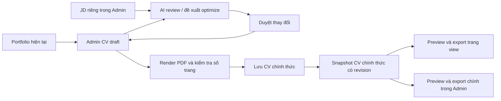

# Kế hoạch đồng bộ CV public và Admin CV

Ngày phân tích: 10/10/2026, Asia/Saigon. Trạng thái: kế hoạch, chưa sửa mã sản phẩm.

## 1. Yêu cầu và quyết định thiết kế

Hệ thống có một CV chính thức, được cấu hình trong Admin. Trang view chỉ preview và tải CV chính thức đó. Nội dung, thứ tự, trường được chọn, câu chữ do AI tối ưu, font, spacing, bố cục và số trang phải giống nhau giữa hai nơi.

Các quy tắc đề xuất:

1. Admin mở mặc định bản CV chính thức mới nhất. Draft cũ trên thiết bị chỉ được khôi phục chủ động, không tự thay bản chính thức.
2. Chỉnh tay, AI Review và Optimize theo JD làm việc trên draft. `Lưu CV chính thức` lưu bản đã preview và hợp lệ, đồng thời cập nhật CV mà trang view sử dụng. Thao tác này thay cho sự phân tách khó hiểu giữa Save Draft và Publish hiện nay.
3. Nút export chính ở Admin và trang view đều tải CV chính thức. Khi draft có thay đổi, Admin có thể dùng `Lưu & tải PDF`: kiểm tra, lưu thành công rồi tải bản vừa lưu. Không tải draft qua nút export chính trong khi public còn dùng bản khác.
4. CV chính thức giữ nguyên cho đến lần lưu tiếp theo trong Admin. Sửa portfolio đánh dấu CV cần rà soát, không tự xóa câu chữ AI hoặc thay bản CV đã chốt.
5. Chọn 2 trang là mục tiêu tối đa 2 trang của bản hoàn tất. CV dài hơn phải qua bước fit nội dung có duyệt; không coi PDF 6–7 trang là bản hoàn tất của cấu hình 2 trang. Không thêm trang trắng nếu nội dung chỉ cần 1 trang.
6. JD và báo cáo AI lưu riêng trong vùng Admin. Chỉ nội dung CV đã duyệt được đưa vào bản public. Bản tối ưu theo JD có thể trở thành CV chính thức bằng chính thao tác lưu này; không bắt buộc có một Base CV khác với CV đang cấu hình.

Điểm 4 là lựa chọn thiết kế để bảo đảm “CV config là bản cuối cùng”. Đây là thay đổi so với cơ chế auto-sync portfolio hiện tại. Dữ liệu portfolio vẫn là nguồn để cập nhật draft và kiểm tra bằng chứng.

## 2. Phát hiện từ mã hiện tại

| Vấn đề | Nguồn | Hệ quả |
|---|---|---|
| Public gọi `resolvePublicCv()` rồi `createPublicCvPdf()` | `js/page/cv-download.js:24–25` | Sau khi đọc config, public tiếp tục biến đổi CV |
| Public tự chọn lại nội dung, rút câu và ép `pageLimit:2` | `js/cv/public-summary.js` | Có thể mất project, bullet, certificate hoặc câu chữ dài đã được duyệt trong Admin; bỏ qua số trang config |
| Admin render trực tiếp fields đang chỉnh với style hiện tại | `js/admin/cv-tools.js:26–28` | Cùng PDF engine nhưng khác đầu vào với public |
| `createCvPdf()` chỉ render rồi thử 10 pt, line height 1.12, margin 13 mm | `js/cv/pdf.js:128–137` | Giới hạn trang chưa phải workflow đưa nội dung về số trang đó |
| Save Draft chỉ ghi `portfolio.cvDraft.v2` trong localStorage | `js/admin/cv-tools.js:46` | Lưu trên máy không cập nhật CV public |
| Admin ưu tiên draft local khi mở | `js/admin/cv-tools.js:39–41` | Draft cũ có thể che cấu hình mới từ thiết bị/tab khác |
| Publish lưu overrides/selection/style và `autoSync:true`, không lưu nội dung đã resolve | `js/admin/cv-tools.js:55` | Portfolio đổi có thể làm CV chính thức đổi ngoài quy trình review |
| Stale overrides bị loại khi source đổi | `js/cv/model.js`, `js/cv/service.js`, event cuối `cv-tools.js` | Câu chữ đã tối ưu có thể bị thay lại bằng source, dẫn đến dài hơn hoặc khác JD |
| Download Admin tạo PDF lại | `js/admin/cv-tools.js:54` | Không dùng trực tiếp kết quả preview đã kiểm tra |
| AI chỉ kiểm tra snapshot của fields, chưa gồm style/JD/page budget/session | `js/admin/cv-tools.js:57–67` | Có thể áp dụng đề xuất đã lỗi thời sau khi đổi mục tiêu |
| AI Optimize chỉ nhận fields được chọn và chỉ được rewrite | `js/admin/cv-tools.js:61` | Không gợi ý đưa project liên quan đã bị loại trở lại, hoặc điều chỉnh selection để đủ trang |
| Publish đọc revision mới nhất ngay trước khi ghi | `js/admin/cv-tools.js:55` | Draft từ phiên bản cũ có thể ghi đè phiên bản mới mà không báo conflict đúng ý nghĩa |
| Read helper ưu tiên pending local write | `js/firebase-config.js:135–153` | Cùng máy có thể đọc bản chưa sync và hiểu nhầm đó là bản public đã lưu |

### Kiểm tra đã thực hiện

Đã chạy Edge headless trên localhost, dùng mock Firebase sẵn có trong `tests/browser-regression.cjs`; không đăng nhập thật, không ghi Firestore thật, không gọi AI.

- Seed đầy đủ, Admin chọn 2 trang: PDF thực tế **6 trang**, 2.711 từ; Download và Publish bị khóa.
- Bấm `Use application selection`: Admin ra **2 trang**.
- Public cùng seed: **2 trang**, thông báo tự tóm tắt.

Đây là bằng chứng hai luồng chọn nội dung khác nhau. Chưa xác minh draft/live data tạo ra 7 trang của người dùng; không kết luận số trang là lỗi bộ đếm. Các unit/browser test hiện tại còn xác nhận auto-summary và tự loại rewrite stale; chúng phải được sửa theo contract mới.

## 3. Luồng dữ liệu mục tiêu

### Bản chính thức: `portfolio/cv`, schema version 4

Lưu tối thiểu: `version`, `_revision`, `publishedAt`, `fields` đã resolve theo đúng thứ tự, `requestedStyle`, `effectiveStyle`, `pageLimit`, `pageCount`, `contentHash`, `rendererVersion` và fingerprint nguồn để nhận biết portfolio đã thay đổi.

- `fields` chứa đúng text/link/section/kind/group/key được dùng để render, không chỉ overrides tham chiếu source sống.
- `effectiveStyle` là cấu hình sau fit mà người dùng thực sự đã preview. Public không chạy lại tối ưu, không thay selection và không có page limit riêng.
- Hash tính từ payload render chuẩn hóa, gồm text, link, thứ tự, style và phiên bản renderer. Không đưa thời gian lưu/revision vào hash nội dung.
- Whitelist payload public: không có JD, AI output, API key hoặc ghi chú riêng. Giữ public-read/admin-write như hiện tại, kiểm tra giới hạn payload đang có.
- Fingerprint/hash dùng xác định bản và cache; không thay cơ chế quyền hoặc conflict theo revision.

### Draft riêng: `admin/cv-draft`

Giữ fields/selection/overrides, nguồn gốc từng field, style, JD, báo cáo/đề xuất AI, `baseCvRevision`, fingerprint source/JD, trạng thái cần review và version schema. Draft là bản làm việc được lưu riêng; localStorage chỉ phục hồi thay đổi chưa sync.

Mở Admin: load bản chính thức trước; nếu có draft khác thì hiện lựa chọn khôi phục kèm thời gian, revision gốc và trạng thái source. Không tự áp draft local lên bản chính thức. Khi portfolio đổi, giữ nội dung draft, đánh dấu trường liên quan cần đối chiếu và cho chọn giữ rewrite/nhận text mới; không xóa override tự động.

### Hợp đồng PDF dùng chung

Shared service trả một artifact gồm `fields`, style hiệu lực, hash, revision/session, `blob`, `pages`, `pageLimit`, `fits`. Preview và download trong cùng phiên dùng **cùng blob**; không dựng lại PDF khi bấm tải.

Hai nơi dùng cùng snapshot và cùng render path. Tiêu chí mặc định là giống nội dung, layout, link và số trang; hai lần generate độc lập có thể khác byte vì PDF metadata. Nếu yêu cầu cùng một file tuyệt đối từng byte, bổ sung lưu PDF artifact theo revision vào storage và hai nơi tải cùng URL; đây là phần mở rộng hạ tầng, không giả định storage đã có.

Khi nâng cấp renderer/font, kiểm tra lại snapshot; nếu thay đổi pagination thì yêu cầu Admin review trước khi chuyển renderer của bản chính thức. Không âm thầm render snapshot cũ bằng renderer mới rồi đổi số trang.

## 4. Workflow số trang và tối ưu Admin

Đổi nhóm control thành `Mục tiêu số trang`, `Fit nội dung`, `Nội dung`, `Định dạng`, `AI/JD`, `Lưu & xuất`. Hiện rõ `Mục tiêu: 2 · Thực tế: 7 · Chưa đạt`, thông số style hiệu lực và trạng thái draft/chính thức.

Khi chọn 2 trang:

1. Invalidate kết quả cũ ngay; render đo PDF thật với mục tiêu mới. Không tiếp tục hiển thị iframe cũ như preview đã hợp lệ.
2. Nếu đã vừa, cập nhật preview hoàn tất từ artifact mới.
3. Nếu vượt, thử fit spacing/style trong giới hạn đọc được; hiển thị mọi thay đổi style hiệu lực. Giữ font body tối thiểu 10 pt, lề tối thiểu 13 mm; không crop hoặc làm chữ quá nhỏ.
4. Nếu vẫn vượt, mở bước `Fit về 2 trang`. Có phương án dùng câu brief từ source/selection preset và phương án AI theo JD. Mọi thay đổi text/selection đều có diff và lý do; không âm thầm bỏ nội dung.
5. Người dùng duyệt phương án; render lại bằng đúng nội dung sau duyệt. Chỉ hoàn tất khi `actualPages <= targetPages`.
6. Nếu chưa vừa, báo phần còn dài và đề xuất tiếp. Giới hạn số lượt AI/render tự động, hỗ trợ cancel/undo; không gọi AI liên tục hoặc hứa mọi bộ dữ liệu đều fit 2 trang.

PDF vượt trang có thể xem như **bản chẩn đoán chưa đạt**, phải gắn nhãn rõ. Nó không được lưu thành bản chính thức hoặc tải qua export chính. CV chính thức hiện tại vẫn tải được qua thao tác riêng có nhãn và revision rõ ràng.

Không thể giữ nguyên toàn bộ 7 trang thông tin, giữ cỡ chữ dễ đọc, đồng thời buộc thành 2 trang. Vì vậy, plan biến chọn 2 trang thành workflow rút gọn có duyệt, thay vì chỉ đổi con số trong dropdown hoặc cắt bỏ 5 trang.

## 5. AI Review và Optimize theo JD

Tách hai hành động:

- **Review:** kiểm tra CV hiện tại so với JD, chỉ ra yêu cầu có bằng chứng/thiếu/chưa đủ thông tin, bullet dài, nội dung ít liên quan, thông tin thời gian và số trang thực tế. Kết quả không sửa CV.
- **Optimize:** trả đề xuất rewrite, thêm lại field có nguồn đã bị loại, ưu tiên/sắp xếp project/bullet, hoặc loại nội dung ít liên quan để đạt page budget. Mỗi đề xuất có key, before/after, lý do và source reference.

Context gồm toàn bộ nguồn CV được phép, CV draft thực tế, JD, selection, style và số trang mới đo. Phân biệt “không có trong CV” với “không có bằng chứng trong portfolio”. Không suy diễn AI score thành kết quả ATS thực tế.

Kiểm tra schema, key hợp lệ, action allowlist, text length và facts được bảo vệ như tên công ty/ngày/chứng nhận/số liệu. Model có instruction không bịa; vẫn cần duyệt của người dùng vì kiểm tra schema không chứng minh mọi câu đều đúng.

Đề xuất được duyệt áp vào cùng draft model; không viết vào portfolio gốc. Sau Apply phải invalidate preview, render/đếm lại trang rồi mới cho lưu. Có Undo theo nhóm thay đổi. JD draft được lưu riêng để đóng/mở không mất.

Fingerprint request gồm draft/source/style/page budget/JD/model settings và session ID. Nếu bất kỳ thành phần nào đổi, đánh dấu kết quả stale, không cho áp. Request đang chạy không được dùng PDF cũ hoặc `pages:0` như một kết quả review hợp lệ.

## 6. Lưu, đồng bộ và tác vụ bất đồng bộ

- Lưu dùng `baseCvRevision` tại lúc mở/khôi phục draft. Conflict buộc reload/đối chiếu; không đọc revision mới rồi gắn lên draft cũ để ghi đè.
- Chụp snapshot bất biến của draft đã render. Giữ generation/hash cho cả render, review, apply, save và download; callback của phiên cũ không tác động phiên mới.
- Nút lưu chỉ hoạt động khi artifact đúng hash draft, render xong và đạt page budget. Khóa mutation trong thời gian commit hoặc kiểm tra lại hash trước commit.
- Sau save online thành công: cập nhật official snapshot/revision/cache, cập nhật baseline draft và phát `cv-published-changed`. Public mở mới đọc bản mới; dialog đang mở chuyển trạng thái tải lại khi online, khóa tải trong lúc thay artifact để tránh giữ nhãn revision mới nhưng file cũ.
- Pending/offline không được báo đã cập nhật public. Giữ official revision cũ và draft pending riêng. Public chỉ dùng snapshot đã xác nhận synced hoặc cache chính thức gần nhất, không dùng helper ưu tiên pending local cho CV chính thức.
- Offline có thể xem/tải bản chính thức đã cache, kèm thời gian/revision. Không có cache thì báo chưa tải được CV; không dựng một bản khác từ seed.
- Theo dõi cập nhật revision giữa tab/thiết bị bằng event nội bộ, storage/BroadcastChannel và refresh/read hoặc listener thích hợp. Draft đang sửa không bị ghi đè; báo đã có bản chính thức mới.

## 7. Thứ tự triển khai

| Giai đoạn | Công việc | Kết quả nghiệm thu |
|---|---|---|
| 1 — Contract và migration | Schema v4, official/draft reader, revision/hash, bảo toàn v3/local draft | Bản chính thức không bị draft local hoặc pending write thay thế |
| 2 — Đồng bộ export | Public bỏ auto-summary; Admin/public cùng official resolver và PDF artifact; sửa download/save | Hai nơi cùng revision cho CV giống text, link, thứ tự, style và trang |
| 3 — Fit số trang | UI target/actual, pipeline fit có duyệt, effective style, invalidation/cancel/undo | Chọn 2 trang có quy trình tạo bản hoàn tất <=2 trang; overflow không thể lưu chính thức |
| 4 — AI/JD | Context đầy đủ, schema/diff/source refs, apply/undo, fingerprint và private persistence | Đề xuất duyệt được phản ánh trong preview, save và public export |
| 5 — Persistence và regression | Conflict/offline/multi-tab, migration/browser/PDF tests, docs | Không mất rewrite, không công khai JD, không báo sync sai |

Các file dự kiến:

- `js/cv/model.js`: schema/validation, provenance và mapping selection; bỏ auto-invalidation đối với bản chính thức.
- `js/cv/service.js`: resolve official snapshot, draft, migration và artifact service dùng chung.
- `js/cv/pdf.js`: render style hiệu lực, pagination chính xác, kết quả artifact; không tự sửa text.
- Module mới `js/cv/fit.js`: dựng phương án fit và kiểm tra page budget, chỉ áp sau duyệt.
- `js/page/cv-download.js`: chỉ đọc/render/tải CV chính thức; trạng thái cache/revision/refresh.
- `js/cv/public-summary.js`: loại khỏi public path; nếu tái sử dụng thì chỉ làm proposal trong Admin, giữ diff đầy đủ.
- `js/admin/cv-tools.js`, `js/admin/cv-styles.js`: UI/workflow mới và state machine; có thể tách AI/proposals/persistence để giảm dùng state global.
- `js/firebase-config.js`, `js/local-portfolio-cache.js`: đọc official không lẫn pending; giữ expected revision đúng lúc bắt đầu sửa.
- `tests/cv-model.test.mjs`, `tests/public-cv.test.mjs`, `tests/cv-upgrade.cjs`, `tests/verify-pdf.py` và browser tests liên quan: thay assertion nghiệp vụ cũ.

Không yêu cầu đổi framework, đổi bố cục portfolio hoặc triển khai toàn bộ Admin Workspace/AI Provider plan cũ. Các quy tắc cũ về tự cập nhật CV theo portfolio, public luôn tóm tắt 2 trang, hay luôn tách JD CV khỏi public được thay bằng yêu cầu CV chính thức hiện tại trong phạm vi này.

## 8. Migration không làm mất cấu hình

1. Sao lưu v3 và draft local trước chuyển đổi. Không lấy `cv/CV_TranTanPhat_SeniorQA.html` làm nguồn thay thế.
2. Với v3 đã publish: resolve selection/overrides bằng adapter tương thích, render theo config hiện có; báo các override không còn khớp nguồn để người dùng đối chiếu. Không áp public-summary và không tự bỏ thêm nội dung.
3. Nếu đạt page budget, tạo candidate snapshot v4 để Admin preview và lưu. Nếu vượt trang, yêu cầu đi qua fit; không migration âm thầm thành bản khác.
4. Nếu không có published config, Admin tạo CV đầu tiên từ portfolio và lưu sau review. Public hiện trạng thái chưa có CV chính thức hoặc giữ legacy file đã xác định rõ trong thời gian chuyển đổi; không tự generate một CV độc lập.
5. Migrate draft local sang bản có `baseCvRevision`; khi không xác định được revision gốc, coi là draft cần đối chiếu, không giả định trùng bản mới nhất.
6. Giữ reader legacy trong thời gian chuyển đổi và ghi schema v4 cho lần lưu mới. Việc chuyển dữ liệu thật thực hiện cùng triển khai, không nằm trong lượt phân tích này.

## 9. Bộ nghiệm thu bắt buộc

| Tình huống | Kết quả cần đạt |
|---|---|
| Chỉnh summary, chọn project/certificate, font và số trang rồi lưu | Public và Admin official export giống toàn bộ cấu hình |
| Publish nội dung AI dài hoặc nhiều project | Public không tự excerpt/cắt bullets hoặc chọn lại fields |
| Config 3/4 trang | Public giữ đúng config, không ép 2 trang |
| Seed/live fixture dài 6–7 trang, chọn 2 | Có trạng thái vượt mục tiêu và phương án fit; bản hoàn tất <=2, không crop |
| Fit không thành công hoặc AI lỗi | Giữ draft và CV chính thức trước đó, giải thích cách tiếp tục |
| Draft chưa lưu hoặc local draft cũ | Public không đổi; Admin export chính vẫn dùng revision chính thức rõ ràng |
| AI Optimize theo JD rồi Apply/Lưu | Text/selection đã duyệt xuất hiện trong cả hai PDF |
| Portfolio đổi sau lưu CV | CV chính thức giữ nguyên; Admin báo cần rà soát source, không mất rewrite |
| Đổi style/JD/selection khi AI đang chạy | Kết quả cũ stale và không áp được |
| Render cũ hoàn tất sau render mới, đóng/mở dialog | Không thay artifact phiên mới hoặc mở lại nút tải sai |
| Hai tab hoặc hai thiết bị cùng sửa | Revision cũ bị conflict, không ghi đè âm thầm |
| Offline save/pending/quota/auth error | Báo đúng trạng thái; không coi pending là CV đã public |
| PDF thực tế | PyMuPDF xác nhận số trang, text Unicode, links, thứ tự text và không mất nội dung đã chọn |
| Privacy | JD/báo cáo/secret không có trong snapshot public hoặc seed public |

Kiểm thử ưu tiên E2E Admin lưu -> public mở -> tải hai PDF và so sánh text từng trang, hyperlinks, media box, page count và ảnh render trong cùng môi trường/font. Kiểm tra artifact hash và cùng blob cho preview/download trong từng phiên. Không dùng byte-equality giữa hai lần tạo PDF độc lập làm tiêu chí mặc định.

Sau thay đổi chạy unit tests, browser regression phù hợp và verify PDF trên artifacts vừa tạo; kiểm tra desktop/mobile, Escape, sign-out và phục hồi draft. Chỉ ghi kết quả đã chạy, không dùng artifacts cũ làm bằng chứng cho code mới.
