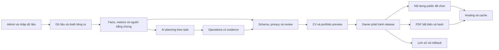

# Lộ trình hệ thống Portfolio, CV và AI: 2026–2031

Ngày lập: 11/10/2026. Khoảng thời gian: 11/10/2026–11/10/2031.
Trạng thái cập nhật 11/10/2026: đã triển khai local hai hạng mục typed career facts/evidence và immutable official PDF/release history/rollback. Xem [báo cáo triển khai và vận hành](CAREER_FACTS_AND_IMMUTABLE_CV.md). Audit baseline bên dưới mô tả trạng thái trước thay đổi; các đề xuất còn lại vẫn là kế hoạch. Chưa deploy rules/CORS hoặc publish dữ liệu lên production trong session này.

## 1. Định hướng

Ưu tiên biến hệ thống thành nơi lưu hồ sơ nghề nghiệp có bằng chứng, từ đó tạo portfolio/CV đúng và nhất quán. Không đặt trọng tâm vào số lượng tính năng AI. Với một owner và dữ liệu hiện tại, Vanilla JS, Firestore và backend Node nhỏ vẫn phù hợp; chưa có lý do để viết lại toàn bộ hoặc triển khai microservices.

Thứ tự đầu tư: dữ liệu chính xác → phục hồi và phát hành ổn định → AI có thể đo chất lượng → trải nghiệm ứng tuyển → mở rộng khi có nhu cầu thực tế. Giữ public website nhẹ, hoạt động độc lập với dịch vụ AI.

Giả định để lập plan: một owner, một người phát triển, lượng dữ liệu nghề nghiệp nhỏ, chưa có yêu cầu SaaS/multi-tenant. Chưa có số liệu traffic, ngân sách hoặc thời gian bảo trì; các mục tiêu và ước lượng dưới đây là đề xuất, cần điều chỉnh sau khi đo baseline. Không dự đoán model hay giá dịch vụ đến năm 2031.

## 2. Hiện trạng đã kiểm tra

| Thành phần | Đã có | Khoảng trống ảnh hưởng dài hạn |
|---|---|---|
| CV | Snapshot v4, renderer v1/v2, PDF checks, diff/Undo, private variants | Public download vẫn render lại snapshot bằng thư viện đang được deploy; nâng font/pdfmake có thể đổi pagination dù rendererVersion không đổi |
| AI | Provider adapters, JSON schema, owner auth, timeout/cancel, freshness, proposals | Chưa có bộ eval ngữ nghĩa, task-level budget, cost ledger hoặc version prompt/policy độc lập |
| Dữ liệu | Stable IDs, revision/CAS, offline pending queue, public/private separation | Dates, skills, metrics, credential type phần lớn nằm trong text; không có evidence/provenance/verification lifecycle thống nhất |
| ID | UUID cho item mới, migration legacy hash | Hash legacy dùng path/index/text khi item chưa có ID; cần persist migration một lần, không dựa vào tính toán lại sau reorder |
| Validation AI | Key allowlist, required identity, numeric/technology checks | Numeric check dùng substring và danh sách technology cố định; chưa chứng minh đúng đơn vị, phạm vi hay quan hệ giữa claim và source |
| Public data | Cache/seed fallback, auto-refresh 60 giây | Refresh toàn bộ docs theo visitor/focus; số reads có thể tăng theo traffic và tab; chưa có public release/cache manifest |
| Backend AI | Queue tối đa 10, 2 jobs chạy đồng thời, cleanup, credential version | Queue/results ở RAM; mất job khi restart, chưa có idempotency/rate limit theo owner hay reservation chi phí |
| Auth/rules | Auth thực, JWT issuer/audience/expiry, email owner, admin-only docs | Chưa bind owner UID trong policy; rules chủ yếu kiểm tra quyền, ít schema/invariant validation; chưa thấy Emulator Rules suite |
| Secrets | Key mới ở vault/backend, không public | Vault local lưu JSON ngoài repo; legacy Custom API có base64 key phía client, không phải encryption; thiếu migration chấm dứt legacy và OS-backed protection |
| Build/test | Lockfile, 48 tests ở lần triển khai CV, nhiều browser/PDF suites | Không tìm thấy workflow CI trong checkout; browser hardcode msedge và PDF Python cần dependencies; chưa có reproducible release manifest |
| Dependencies | Build CSS/vendor local; Docker Node 24 | Firebase CDN 10.12.0; có external CDN và EmailJS major-range; không có engines/runtime policy hoặc quy trình upgrade rollback thống nhất |
| Docs | README, CLAUDE.md, nhiều implementation plans | Một số tài liệu vẫn mô tả Tailwind CDN, jsPDF, chưa có tests; dễ dẫn agent làm theo kiến trúc cũ |

Audit dependency ngày 11/10/2026: `npm audit --json` báo 5 package high, 0 critical, trong chuỗi Tailwind build (`braces`, `chokidar`, `fast-glob`, `micromatch`, `tailwindcss`). `npm audit --omit=dev --json` báo 0 vulnerabilities. Đây là số package bị ảnh hưởng, không khẳng định có 5 lỗ hổng độc lập hoặc production hiện bị khai thác. Audit gợi ý một số fix cần major upgrade; cần đánh giá cách cập nhật transitive/build chain và test CSS, không tự chạy force upgrade. [Advisory được audit trả về](https://github.com/advisories/GHSA-vfj7-8cjw-p6xm).

Phạm vi kết luận là source local. Không xác nhận console production đã bật backup, App Check, MFA, đúng rules hay billing budget; những phần đó cần audit deployment riêng khi có quyền truy cập.

## 3. Kiến trúc đích

Backend không cần phục vụ mọi lượt xem public. AI không ghi trực tiếp vào dữ liệu official. Release public chỉ chứa các field đã được chọn và được phép public; không chứa JD, context, source evidence riêng tư hoặc secrets.

## 4. Dữ liệu và fields nên bổ sung — ưu tiên cao nhất

### 4.1 Các entity tối thiểu

| Entity | Fields đề xuất | Mục đích |
|---|---|---|
| Profile | `legalName`, `displayName`, `headlineByLocale`, `targetRoles`, `location`, `timezone`, `contactPreferences` | Nhất quán tên hiển thị và vai trò mục tiêu; tách ngôn ngữ khỏi facts |
| Experience | `id`, `employer`, `officialTitle`, `displayTitle`, `startDate`, `endDate`, `isCurrent`, `employmentType`, `promotionHistory`, `responsibilityIds`, `achievementIds` | Dates có cấu trúc, title đúng, theo dõi thăng tiến và tránh mô tả job lặp summary |
| Project | `id`, `experienceId`, `domain`, `role`, `teamSize`, `ownership`, `startDate`, `endDate`, `technologyIds`, `claimIds`, `caseStudy`, `confidentiality` | Phân biệt đóng góp cá nhân với team; chọn dự án theo JD |
| Achievement/Claim | `id`, `statement`, `claimType`, `scope`, `contribution`, `metricIds`, `evidenceIds`, `verificationStatus`, `reviewedAt` | Tách câu chữ khỏi fact và bằng chứng; không để AI đổi ý nghĩa |
| Metric | `id`, `value`, `unit`, `baseline`, `comparisonValue`, `measurementPeriod`, `environment`, `workload`, `method`, `owner`, `limitations` | Kiểm tra số liệu đúng đơn vị và phạm vi, không chỉ có cùng chữ số |
| Skill | `id`, `canonicalName`, `aliases`, `category`, `lastUsedAt`, `practicalExperience`, `projectIds`, `evidenceIds` | Biết kỹ năng thực hành, mức liên quan và thời điểm dùng gần nhất |
| Credential | `id`, `kind`, `title`, `issuer`, `issuedAt`, `expiresAt`, `credentialId`, `verificationUrl`, `verificationStatus` | Phân biệt official certification, course completion, badge và học thuật |
| Language | `language`, `selfReportedLevel`, `certifiedLevel`, `assessmentName`, `assessedAt`, `evidenceIds` | Không tự suy ra CEFR/IELTS hoặc mức giao tiếp từ một chứng nhận không rõ |
| Evidence | `id`, `kind`, `reference`, `contentHash`, `excerpt`, `owner`, `visibility`, `verifiedBy`, `verifiedAt`, `retentionPolicy` | Truy xuất nguồn, quản lý riêng tư và dữ liệu hết hạn |
| Application | `id`, `company`, `role`, `jdVersion`, `appliedAt`, `stage`, `cvReleaseId`, `followUpAt`, `notes`, `outcome` | Biết chính xác CV nào đã gửi cho từng job |
| CV variant/release | `id`, `sourceRevision`, `factRevision`, `configVersion`, `promptVersion`, `modelResolvedId`, `pdfHash`, `publishedAt`, `reviewedBy` | Tái hiện, so sánh và rollback được |

Không bắt người dùng nhập toàn bộ fields một lần. UI dùng progressive disclosure, ưu tiên 10 fields đầu tiên: dates có cấu trúc, officialTitle, contribution, metric value/unit/context, credential kind, verificationStatus và evidenceIds. Field chưa biết phải được phép null/unknown; AI không tự điền.

### 4.2 Ví dụ ngay trên CV hiện tại

Claim “200,000+ records within 2 seconds” cần lưu recordCount, duration, workload/test method, môi trường và đóng góp QA. Chưa biết concurrency hoặc percentile thì giữ unknown, không biến thành “200K concurrent users”, throughput hoặc SLA.

Claim “12 security vulnerabilities” cần lưu số finding, phạm vi test, vai trò phát hiện và kiểm tra bản sửa; không tự coi owner là người remediation.

ISTQB khóa Udemy: `kind=course_completion`; chỉ chuyển `official_certification` khi có bằng chứng phù hợp và owner xác nhận. Link tồn tại hoặc HTTP 200 không chứng minh credential hợp lệ hay chưa hết hạn.

### 4.3 Quy tắc xác minh

`unverified → owner_confirmed → externally_verified`; bổ sung `disputed`, `expired`, `needs_review`. Đây là trạng thái theo bằng chứng và người review, không phải phần trăm confidence do LLM tự tạo.

Nội dung public có thể dùng facts owner-confirmed theo policy; claim unverified cần được owner xác nhận trước publish. Mỗi statement AI phải tham chiếu claim IDs; số liệu và credentials dùng render deterministic từ typed data. Evidence riêng tư chỉ có citation công khai đã redacted khi owner chọn.

### 4.4 Migration an toàn

Giữ raw legacy text; parse thành candidate, không tự xác minh. Persist UUID/legacy IDs một lần và lưu bảng ánh xạ keys cũ–mới. Khi migration, bảo toàn CV overrides/variants, origins và source refs. Dùng schemaVersion riêng cho portfolio/evidence/application; không trộn với snapshot/config/renderer version. Có dry-run, backup, compatibility reader và rollback trước khi switch writer.

## 5. AI chính xác, rẻ hơn và thay model được

### 5.1 Chia việc theo khả năng

| Công việc | Cách xử lý ưu tiên |
|---|---|
| Dates, số năm, credential expiry, units, dedupe, schema, PDF pages | Code deterministic; số năm tính theo timeline, không cộng chồng jobs đồng thời |
| Lựa chọn evidence cho JD | Tags/keyword search + filter quyền trước; semantic retrieval nếu corpus đủ lớn |
| Rewrite/translate từ facts | Model theo task, đầu ra structured, fact IDs và review |
| Phân tích JD/thiếu bằng chứng | LLM tạo mapping; validator kiểm tra source, unknown/gap tách rõ |
| Publish, delete, đổi identity/title/credential | Owner hoặc workflow policy; agent chỉ đề xuất |

AI không được tự đổi `200,000 records` thành `200,000 users` dù regex số hợp lệ. Thêm assertion-level evidence checking: statement → entity/metric/relationship → source. Dùng LLM verifier để hỗ trợ phát hiện claim mới, nhưng không coi một model thứ hai là chứng minh sự thật. Claims chưa rõ chuyển thành evidence questions.

### 5.2 Eval trước mỗi lần đổi prompt hoặc model

Tạo corpus 60–100 tình huống đại diện, có nhãn owner-reviewed: tiếng Việt/Anh, JD automation/manual/lead, thiếu evidence, conflicting dates, course vs cert, metric unit confusion, dữ liệu dài, stale revisions, prompt injection và private context. Tách tập development và holdout.

Đo schema success, factual support, unit accuracy, correct unknown/gap, privacy, page fit, owner acceptance/editing effort, latency và cost per accepted draft. Rubric reviewer chấm action/scope/result, clarity và relevance; không tự đặt “ATS pass score”. LLM judge chỉ là tín hiệu phụ; negative cases và owner review là release gate.

Mục tiêu đề xuất: >=98% structured success trên corpus; 0 critical identity/credential/metric fabrications và 0 private leaks trên holdout; 100% malformed/stale/unauthorized operations bị block. Các mục tiêu này là gate trên tập kiểm thử, không cam kết mọi request thực tế đều đúng.

Prompt, task schema, policy và model catalog có version/hash. Lưu resolved model khi provider cung cấp, adapter version, facts/context revision, selected config và usage. Model aliases có thể đổi; nếu không có ID cố định thì ghi rõ giới hạn tái hiện. Chất lượng PDF bytes được bảo toàn riêng, không cần tái gọi model để phục hồi CV.

### 5.3 Kiểm soát chi phí và tốc độ

- Router theo task/capability/eval: model nhỏ cho rewrite đơn giản; model mạnh cho phân tích khó; fallback chỉ sang provider đã được owner chọn cho cùng phân loại dữ liệu.
- Context builder chọn relevant facts thay vì gửi cả portfolio/chat mỗi lần. Cache theo owner + task + input/fact/context revisions + prompt/model/policy; invalidate khi bất kỳ nguồn nào đổi.
- Ledger token/usage/estimated charge theo task/ngày/tháng. Catalog giá có ngày kiểm tra; unknown usage phải hiện unknown, không ghi cost 0.
- Reserve ngân sách trước dispatch; reconcile khi có usage; failed/cancelled request vẫn có thể bị provider tính phí. Chặn job mới khi hết budget, giữ public website hoạt động.
- Retry tối đa cho transient errors, backoff+jitter, idempotency key và tránh duplicate paid jobs. Không retry lỗi policy/schema thành vòng lặp tốn tiền.
- Local queue RAM đủ cho hiện tại. Thêm durable job store chỉ khi có hosted jobs dài hoặc restart gây mất việc thực tế; không cần Redis ngay.

Cloud alerts-only budget không tự chặn chi phí; spend cap có thể có tùy dịch vụ. App vẫn cần budget policy riêng cho AI providers. [Google Cloud budget documentation](https://docs.cloud.google.com/billing/docs/how-to/budgets).

### 5.4 An toàn khi tăng quyền agent

JD, attachments, website content và retrieved evidence đều là data không đáng tin cậy. Giữ tool allowlist, hạn chế quyền ghi, validator ngoài model và review trước publish. Nếu import URL: block private network/cloud metadata, kiểm tra redirects/DNS và MIME/size; local providers và hosted backend có policy network khác nhau. Không cho model tùy ý gọi shell hoặc connector từ nội dung JD. [OWASP Gen AI risks](https://genai.owasp.org/llm-top-10/) mô tả prompt injection, output handling và excessive agency.

## 6. Phát hành, hiệu năng và khả năng phục hồi

### 6.1 PDF official bất biến

Lưu bytes PDF đã duyệt cùng SHA-256, source/config/renderer/font/library fingerprint, page count và text report. Public download dùng đúng file đó; preview và export official dùng cùng artifact. Chỉnh CV mới tạo candidate khác; không render lại official bằng vendor mới.

Publish flow: validate và privacy projection → upload assets vào key bất biến theo hash → tạo release record → transaction CAS đổi public pointer. Nếu upload/validation/CAS fail, pointer cũ giữ nguyên. Rollback đổi pointer về release đã duyệt; không xoá release mới để “undo”. Garbage collection orphan assets chỉ chạy sau retention và reference check.

Public manifest có release ID/hash/locale và approved asset URLs, không có raw private draft. Storage/CDN cost và cache invalidation phải tính trong deployment plan. PDF binary không đặt trong Firestore document.

### 6.2 Portfolio public nhẹ và cập nhật nhất quán

Tạo public JSON/HTML từ cùng facts đã duyệt, phục vụ qua hosting/CDN; dùng manifest revision/ETag thay refresh toàn bộ docs mỗi 60 giây. Owner Admin vẫn làm việc trực tiếp với Firestore. Không mặc định realtime listener cho mọi visitor khi dữ liệu hiếm thay đổi.

Đây là hướng đề xuất theo đặc điểm portfolio ít thay đổi; Firebase cũng có giải pháp bundle dữ liệu chung để phục vụ từ CDN. Có thể dùng static JSON thay Firestore bundle nếu đơn giản hơn. [Firebase CDN bundles](https://firebase.google.com/docs/firestore/solutions/serve-bundles).

HTML public nên render sẵn nội dung quan trọng cho SEO và khi JS/network lỗi; lazy-load Admin và PDF viewer. Hạn chế tải fonts, animation và third-party scripts trên đường render đầu. Pin exact versions, checksum assets và có lockfile. Nâng Firebase/Node/Tailwind/pdf libraries theo từng PR có compatibility tests.

Mục tiêu Web Vitals ở percentile 75 theo hướng dẫn hiện hành: LCP <=2.5s, INP <=200ms, CLS <=0.1. Đo mobile thực và synthetic; traffic ít thì không suy ra kết luận từ mẫu nhỏ. [Web Vitals](https://web.dev/articles/vitals).

### 6.3 Backup, restore và portability

- Backup riêng public release và admin facts/context/variants; private backup phải encrypted, có access controls, retention và restore path.
- Bắt đầu snapshot ngày và sau publish, giữ 30 ngày; export portable định kỳ gồm JSON, assets, manifest/hash và schema versions. Không gộp API keys vào backup thông thường.
- Restore drill theo quý trên staging/Emulator, đối chiếu IDs, refs, CV artifact và quyền public/private.
- Mục tiêu đầu: RPO 24 giờ cho dữ liệu đã sync, RTO 4 giờ; chưa sync nằm trên device phải hiển thị rõ, không nằm trong cloud RPO. Publication artifact cần snapshot sau mỗi publish.
- Firestore scheduled backups và PITR là tùy chọn theo billing/giá trị dữ liệu. PITR hiện hỗ trợ cửa sổ tới 7 ngày và cần billing; không thay long-term archive. [Firestore backups](https://firebase.google.com/docs/firestore/backups), [PITR](https://firebase.google.com/docs/firestore/pitr).
- Có runbook thay owner credential, mất máy, mất Firebase access, outage provider, corrupted migration và rollback release.

### 6.4 Security và privacy

Bind owner UID + verified email/checks phù hợp ở rules và backend, reauthentication cho key/publication operations nhạy cảm. Triển khai migration có test để không khóa owner hiện tại. MFA cho các tài khoản quản trị/cloud nếu khả dụng; policy và recovery được kiểm tra trước bật.

Thêm Firestore Rules schema/invariant constraints và Emulator tests cho public read allowlist, admin deny, forged fields và invalid snapshots. Server SDK có IAM riêng, không dựa vào client rules để bảo vệ server credentials. [Firebase Rules testing](https://firebase.google.com/docs/firestore/security/test-rules-emulator).

App Check hỗ trợ giảm abuse nhưng bổ sung cho Authentication, không thay auth/rules; bật monitoring trước enforcement để tránh chặn owner/local tests. [Firebase App Check](https://firebase.google.com/docs/app-check).

Hoàn tất migration legacy client keys sang backend, xoá key cũ sau xác nhận, rotate nếu cần. Vault Windows dùng credential store/DPAPI hoặc cơ chế OS phù hợp; hosted dùng managed secrets. Không mặc định chmod trên Windows đã bảo vệ file bằng ACL. Thêm rate limits, endpoint restrictions và audit events redacted. Logs không chứa raw key, JWT, private CV/context hoặc toàn bộ JD. CI build/publish chỉ allowlist public assets, không upload repo/test-results/admin backups.

## 7. Tính năng sản phẩm đáng làm

| Ưu tiên | Tính năng | Giá trị | Gate triển khai |
|---|---|---|---|
| P0 | Data health dashboard | Dates sai, duplicate IDs, unverified claims, expired certs, stale CV/source, broken links | Typed fields + evidence status |
| P0 | Release history và rollback | Biết ai đổi gì, phục hồi bản đã duyệt | Immutable release + private audit |
| P1 | Career journal theo tháng | Ghi thành tích khi còn nhớ, giảm CV viết lại từ ký ức | Claim/evidence capture đơn giản |
| P1 | JD evidence matrix có giải thích | Thấy yêu cầu matched/gap/unknown và nguồn thực tế | Canonical skills + claims + eval |
| P1 | Application tracker | Liên kết job, JD và đúng CV đã gửi, follow-up thủ công | Release IDs và private data |
| P1 | Case-study builder | Thể hiện problem, approach, contribution, result và evidence | Confidentiality/redaction controls |
| P1 | EN/VI CV/portfolio | Facts chung, wording theo locale; giảm drift bản dịch | Locale model + translation regression |
| P2 | Interview preparation | STAR stories từ achievements, câu hỏi theo JD, evidence gaps | Không tạo câu chuyện hoặc số liệu mới |
| P2 | Recruiter Q&A public | Hỏi về năng lực trên nguồn public, dẫn citation, trả unknown | Public-only retrieval, rate/cost limits, evaluation |
| P2 | Analytics tối giản | Xem recruiter đọc section và download CV theo tổng hợp | Privacy/retention policy; không suy ra hiring attribution từ pageviews |
| P3 | Connectors/import | Nhập Jira/GitHub/documents rồi owner review thành evidence | Read-only trước, permissions/scopes rõ, tránh dữ liệu client/company bị public |
| P3 | Reviewer role hoặc multi-user | Review workflow khi thật sự có người thứ hai | UID roles, document access model, access tests |

Thêm field availability/work authorization/salary chỉ khi có nhu cầu và owner chọn visibility; mặc định private. Không đưa tuổi, tình trạng hôn nhân, thông tin định danh nhạy cảm hoặc đánh giá personality tự động vào CV mặc định.

Không ưu tiên lúc này: fine-tuning dữ liệu cá nhân nhỏ, vector database trước khi cần retrieval, agent tự gửi hồ sơ/email, auto-publish, nhiều microservices, multi-agent cho mọi task hoặc đổi framework chỉ vì xu hướng. Chỉ mở khi có pain point và chỉ số chứng minh.

## 8. Backlog 90 ngày đầu

Ước lượng effort: một developer quen repo, gồm implementation và tests; chưa gồm chờ quyền cloud, xác minh facts với owner hoặc phí dịch vụ. Các khoảng ngày là ngày công, không cam kết lịch.

| Ticket | Deliverable | Phụ thuộc | Effort | Nghiệm thu |
|---|---|---|---|---|
| F01 | Audit/fix build dependencies, runtime policy, docs thống nhất | Không | 3–5 ngày | Advisory được xử lý hoặc có risk acceptance cụ thể; CSS/browser/PDF tests pass; engines/version policy rõ |
| F02 | CI portable, staging, release checklist | F01 | 4–6 ngày | CI tự start server, install Chromium/Python, run tests/build/PDF; không hardcode Edge; secret scan và artifact allowlist |
| F03 | Backup/export + restore drill đầu | Không | 3–5 ngày | Restore staging đúng IDs/refs và privacy; RPO/RTO đo được |
| F04 | Auth/rules/backend hardening MVP | F02 | 4–6 ngày | UID migration có rollback; Emulator allow/deny tests; legacy key migration; rate-limit basics |
| F05 | Typed dates, credential kind, claims/metrics/evidence MVP | F03 | 7–12 ngày | Dry-run không mất overrides/variants; 200K records/2s và ISTQB course mô hình hóa đúng; unknown không tự thành verified |
| F06 | Immutable official PDF + release pointer | F02, F03 | 5–8 ngày | Vendor upgrade không đổi bytes official; failed publish giữ release cũ; rollback pass |
| F07 | AI eval corpus + budget/usage MVP | F05 | 6–10 ngày | 60+ cases, critical gates, token/cost unknown handling, không dispatch quá app budget |

Tổng khoảng 32–52 ngày công nếu làm đủ. Trong 90 ngày lịch với thời gian part-time hạn chế, ưu tiên F01/F02/F03/F06 và typed credential/metric MVP; tách phần hardening/eval nâng cao sang quý tiếp theo. Không cắt tests/backup để vừa deadline.

Sau baseline mới quyết định public JSON/CDN refactor lớn và nâng framework. Quick wins tuần đầu: audit, canonical docs, ghi claim/credential types, backup trước thay đổi, kiểm tra deployment state. Không bật billing service/deploy rules khi chưa kiểm tra tác động chi phí và owner access.

## 9. Roadmap 5 năm có điều kiện

| Giai đoạn | Mục tiêu | Nội dung | Gate kết thúc |
|---|---|---|---|
| Năm 1: 10/2026–10/2027 | Độ tin cậy và phát hành ổn định | F01–F07; public artifact/cache; data health; monthly journal | Restore và rollback được; model change có eval; official CV không phụ thuộc renderer đang chạy |
| Năm 2: 10/2027–10/2028 | Hỗ trợ ứng tuyển có bằng chứng | Application tracker, JD evidence, case studies, EN/VI, interview prep | Mỗi application trỏ đúng CV/JD; locale facts không drift; owner tiết kiệm editing effort so baseline |
| Năm 3: 10/2028–10/2029 | Hiệu năng và tự động hóa có kiểm soát | Targeted retrieval, cost router, optional public Q&A, analytics privacy | Quality không giảm khi giảm cost; public QA không lấy private context; có usage đủ để đánh giá |
| Năm 4: 10/2029–10/2030 | Tích hợp và review mở rộng khi cần | Read-only connectors, optional reviewer roles; background jobs khi có nhu cầu | Least-privilege/access tests; import không auto-publish; restart không duplicate paid jobs |
| Năm 5: 10/2030–10/2031 | Portability và refresh công nghệ | Full restore/export exercise, đánh giá lại runtime/SDK/provider/hosting; bỏ legacy đã có migration | Đổi provider/hosting không mất facts/history/artifacts; archive đọc được; chi phí và maintenance nằm trong budget |

Mỗi quý reprioritize theo jobs thực tế, traffic, cost và effort. Đây là lộ trình thích ứng, không bắt buộc thêm mọi tính năng vào đúng năm hoặc giữ nguyên công nghệ suốt 5 năm.

## 10. Chỉ số và lịch bảo trì

| Chỉ số | Baseline hiện tại | Mục tiêu đề xuất |
|---|---|---|
| Fact provenance | Text/source keys; chưa đủ typed evidence | 100% numerical/credential claims trong bản mới có evidence/status và owner review |
| PDF integrity | Runtime render + checks | Bytes official bất biến; Admin/public same hash; no missing selected text |
| Restore | Chưa thấy drill được ghi nhận | Quarterly pass; synced-data RPO <=24h, RTO <=4h |
| AI quality | Tests protocol/schema; chưa có semantic eval corpus | Release gates trên holdout; không dùng schema pass thay factuality |
| AI cost | Có usage ở một số adapters, chưa ledger đầy đủ | Budget enforcement trước dispatch; cost/accepted draft, không ghi unknown thành 0 |
| Performance | Chưa đo field baseline | Web Vitals mục tiêu p75; giảm reads theo visitor nhờ public artifacts |
| Workflow value | Chưa đo | Theo dõi thời gian làm CV và edit burden; mục tiêu giảm >=30% so baseline sau 3 tháng, giữ quality |
| Public availability | Chưa có monitoring | Đặt SLO sau baseline; website/CV vẫn phục vụ khi AI lỗi |

Hàng tuần: dependency/security alerts, backup failures, jobs/cost errors. Hàng tháng: cập nhật career journal, review credentials/links/source freshness, eval nhỏ và patch maintenance. Hàng quý: restore drill, prompt/model holdout, public/private access tests, browser/PDF compatibility và ngân sách. Hàng năm: xuất archive, thử rollback hosting/provider, review fields và loại bỏ code/tài liệu obsolete có migration.

Tài liệu chuẩn: một `AGENTS.md` cập nhật kiến trúc/invariants/workflows, README setup ngắn, architecture decision records cho các thay đổi quan trọng. Agent phải đọc đúng source version; các implementation report lịch sử ghi rõ ngày/phạm vi để không trở thành hướng dẫn hiện hành sai.

## 11. Quyết định đầu tư

Nếu chỉ chọn 3 hạng mục: **typed facts + evidence**, **CI/backup/release artifacts**, **AI eval + budget controls**. Ba phần này bảo vệ mọi tính năng tương lai và xử lý các vấn đề đã thấy trong code.

Tài liệu nền để thiết kế eval/risk lifecycle: [NIST Generative AI Profile](https://www.nist.gov/publications/artificial-intelligence-risk-management-framework-generative-artificial-intelligence). Nguồn và khả năng nền tảng được kiểm tra tại thời điểm lập plan; phải kiểm tra lại support/giá/limits khi triển khai từng giai đoạn.
